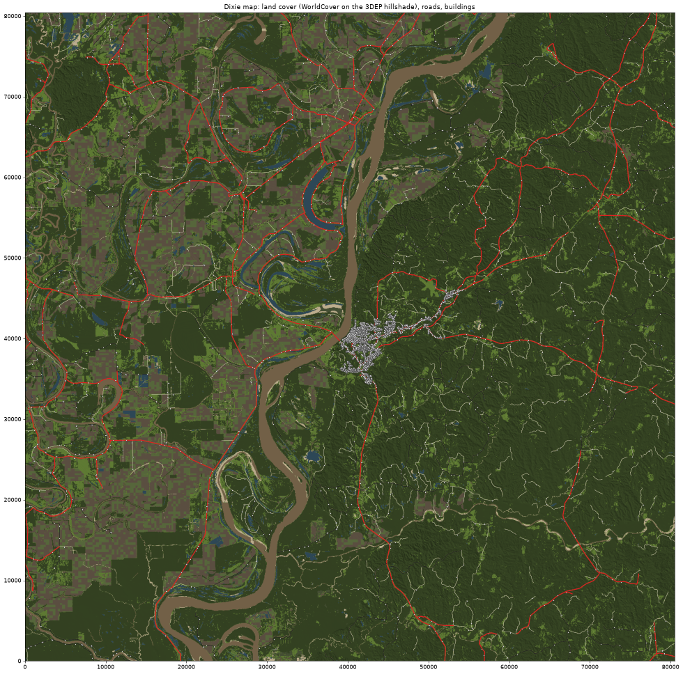
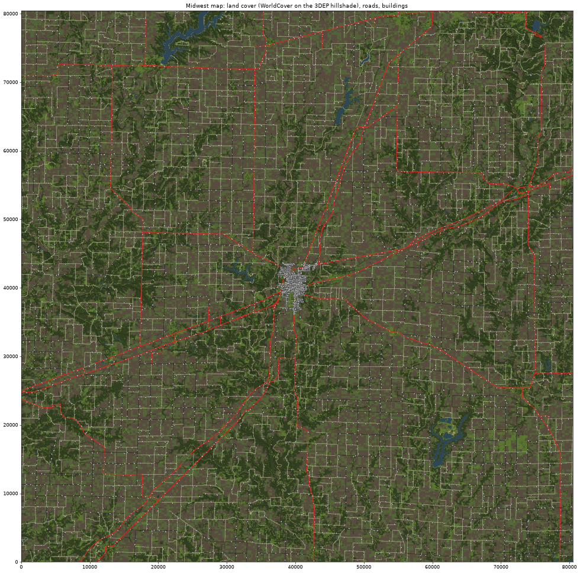

# Real-data maps: Dixie and Midwest

Two 50 x 50 mile drivable maps built from official data, siblings of the plains test map with the same file formats.
In each, the ground, water and land cover come from official data, the roads are a generalised recreation of the
real ones, and the buildings and trees are placed by rules. Each map has one town for now; the other towns are
smoothed out of the ground, their streets left out, and only the highways through them are kept.

| Map | Centre | Scene (menu) | Town | Storm preset | Radar |
| --- | --- | --- | --- | --- | --- |
| `dixie` | Natchez, MS (31.5604 N, 91.4032 W; UTM 15N) | `Assets/Scenes/DixieMap.unity` (**StormLab > Dixie Map**) | Natchez | `dixie` | KDGX |
| `midwest` | Effingham, IL (39.1200 N, 88.5434 W; UTM 16N) | `Assets/Scenes/MidwestMap.unity` (**StormLab > Midwest Map**) | Effingham | `ohio` (Midwest) | KILX |

Every script takes `--map dixie` or `--map midwest`. What differs between the maps (tiles, basins, states, the town,
the big river and its bridge, levees, floodplain, pine share, farm density, radar, start points) is in
`map_config.py` under `SPEC["real"]`. To add a small town later: keep its streets in `roadnet.load_roads` (today only
the town from `land.town_mask` keeps them), and give it buildings in `places.town`.

**Dixie.** The loess bluffs and the Homochitto hills on the Mississippi side; the Concordia Parish delta with its
oxbow lakes, bayous and main-line levee on the Louisiana side; the river between, with one crossing, the
Natchez-Vidalia bridge. Vidalia, Ferriday, Fayette and Washington are smoothed out.



**Midwest.** The Illinois till plain round Effingham: corn and soybean ground on the mile grid, oak-hickory timber
along the Little Wabash, the Embarras, the Kaskaskia and their creeks, Lake Sara, Lake Mattoon and the south end of
Lake Shelbyville, I-57 and I-70 crossing at Effingham with US 40 (the National Road) beside I-70, US 45, IL 32, 33, 37
and 128. Teutopolis, Altamont, Mattoon's edge, Newton, Neoga and the rest are smoothed out.



## What is real and what is designed

| Part | Source |
| --- | --- |
| Terrain | USGS 3DEP 1/3 arc-second DEM (lidar-derived), from The National Map's S3 staged products, resampled to 7.86 m. On flat ground the fills of real roads and railways are clipped as on the plains map; hills are left alone. |
| Levees (Dixie) | Found in the DEM (NHD has no levee lines there): ridges at least 3.5 m above the floodplain and at least 1.5 km long. That catches the Mississippi main-line levee on the Louisiana side and a few smaller ones. |
| Water | USGS NHDPlus HR area and waterbody polygons: rivers, lakes, reservoirs and ponds of 0.4 ha and up. Each is wet where the lidar's hydro-flattened water surface says there was water, and gets its level from that surface. The Mississippi fills its polygon bank to bank, because the lidar caught it at low water and the storm season is its high-water season. Roads crossing water ride 1.5 m above it. |
| Streams | NHDPlus HR flowlines, moved onto the DEM's channel as on the plains map. Rivers (wide, always bridged) are streams draining 500 km2 or more. In Dixie they also include those that run mostly through NHD river polygons, because NHDPlus drainage areas in the delta are unreliable (side channels carry the Mississippi's whole basin). That gives the Homochitto, Buffalo, Coles Creek, Tensas, Black River and the bayous in Dixie, and the Kaskaskia, Embarras, Little Wabash, Muddy, Becks and Big Muddy creeks in the Midwest. |
| Land cover | ESA WorldCover 2021 (10 m). The plains map's USDA Cropland Data Layer server could not be reached from the build machine, and crop type matters little in the storm season. Forest is 67 % of Dixie and 26 % of the Midwest map; cropland is 63 % of the Midwest map. |
| Roads | USGS National Transportation Dataset, generalised. See below. |
| Town | The area where the USGS streets are town-dense (interstates left out): 5 km of road per km2 or more, or 3 km where WorldCover is built up. It must connect to downtown. Its streets are the real ones. Its buildings are placed lot by lot: brick rows downtown, houses elsewhere, stores with parking on the highways, a few churches. |
| Homes, farms, trees, power lines | Placed by rules. Dixie: farm headquarters on the delta floodplain only. Midwest: farmsteads with bins and sheds along the grid roads. |

## Roads

- Kept: interstates, US and state routes and the Natchez Trace Parkway (state class); arterials without a route number
  (paved); named rural roads that run 800 m or more (paved from 6 km up, else gravel); the town's named streets
  (paved). Names are as signed: I-57, US 45, IL 33, LA 15, MS 553.
- Divided highways become one two-lane road. The network is drawn into a 10 m raster (highways 50 m wide), thinned to
  a centre line and traced back to lines. Junctions closer than 45 m are merged. Whiskers, bubbles and interchange
  loops are removed. Forks narrower than 35 degrees are squared up. Lines are smoothed, with a minimum radius of 60 m
  for state roads and 18-20 m for the rest.
- No grade separation: an interstate meets the roads that cross it at junctions.
- Dixie: one road crosses the Mississippi (US 84 / 425), on a 26 m high bridge over the water and the batture. Every
  other road that reached the river stops at the bank.
- Dead ends: rural ones shorter than 1.2 km are pruned, longer ones stay. In town, streets of 100 m or more stay.
- Profiles, grading, junctions and bridges use the plains map's code (`profiles.py`, `world.py`, `meshes.py`).

## Forest

The forest interior is a canopy shell: a flat roof on a 31 m grid at crown height (18-26 m) with a crown texture, pine
or hardwood, closed by vertical walls from the ground to 6 m above the roof. The walls show the edge of the woods: two
rows of lit crowns whose tops are cut out against the sky (alpha-tested), the shade with trunks under them,
understory along the foot (`canopy_side`). (The first build sloped the roof down to the ground over one grid cell
instead; from the road that read as a grassy hill.) It starts 22 m from a road's edge, and no roof corner is within
16 m of one. Real trees stand in front of it: the front row of
the woods along every road, the forest edges within 45 m of a road, and the town's wooded lots. Dixie has loblolly
pine in the hills, oak and sweetgum on the floodplain and bald cypress round the lakes; the Midwest has oak-hickory
with a few pines. The shell has no collider and casts shadows.

## What the last runs made

| | Dixie | Midwest |
| --- | --- | --- |
| Road | 3,048 km (930 km state class), 53 bridges | 6,585 km (790 km state class), 141 bridges |
| Town | Natchez: 7,091 houses, 674 stores, 66 churches | Effingham: 6,118 houses, 419 stores, 43 churches |
| Countryside | 1,407 homes (245 farm headquarters, 399 mobile homes) | 4,905 homes (3,321 farmsteads, 583 mobile homes) |
| Trees | 1.25 million; canopy shell over 61 % of the map | 0.72 million; canopy shell over 20 % |
| Power lines | 1,284 | 3,136 |

## Build

Python 3 with numpy, scipy, shapely, tifffile, imagecodecs (the 3DEP and WorldCover tiles are LZW / deflate
compressed), pyproj, pillow, matplotlib and scikit-image.

```
python -I tools/testmap/real/fetch.py --map midwest       # downloads (3-8 GB in data/raw/testmap/<map>), cut to the map
python -I tools/testmap/real/land.py --map midwest        # DEM, levees, water, streams, land cover, the town's outline
python -I tools/testmap/real/roadnet.py --map midwest     # road network + docs/testmap/<map>/network.png
python -I tools/testmap/real/groundtex.py --map midwest   # ground, canopy and road textures
python -I tools/testmap/real/places.py --map midwest      # profiles, grading, water, buildings, forest, meshes -> <Map>MapData/
python -I tools/testmap/navmap.py --map midwest           # the GPS's road graph and base map
```

The NHDPlus HR zip for the Wabash basin (HU4 0512) is 4 GB and unpacks to 8.6 GB. Once the cut has written
`nhd_*.json` and `tran_roads.json`, the zips can be deleted.

Then **StormLab > Midwest Map > Build World** (or **Dixie Map**) in Unity, or headless:
`-executeMethod TestMapBuilder.BuildMidwestFromCommandLine` (`BuildDixieFromCommandLine`), about 2 minutes. The
generated data (`<Map>MapData/`, `Assets/TestMap/Generated<Map>`, the scenes) is not in git.

In Play, the storm panel's **Map** row (Tab) switches between the plains, Dixie and Midwest maps; the storm setup
and the clock carry over. The storm buttons below it change only the storm.

Checks: **StormLab > Midwest Map > Run Drive Test + Screenshots** (headless: `-executeMethod
TestMapTests.RunFromCommandLine -testmapMap midwest`). The autopilot drives the ten longest highways and the three
longest paved and gravel roads, slowing for curves (3.5 m/s2 sideways); the report is
`validation/reports/<Map>MapReport.md`, the views `Screenshots/<map>_*.png`. Both maps pass (2026-10-28: Dixie 16 of
16 roads, Midwest 15 of 15, within 1.4 m of the centre line). The routes for the autopilot are sampled every 10 m
(the plains map's 25 m cut across these roads' 30-60 m curves).

## Known limits

- Built and driven headless (2026-10-28), not yet played in the editor. Seen in the views and left as they are:
  junction pads are large and irregular where real roads meet at odd angles; the canopy walls are flat faces up close
  and end square; a car that leaves the road into the woods drives under the roof in deep shade, with no trunks.
- Dead ends: 856 rural ones in Dixie and 842 in the Midwest stay (real roads end; only those under 1.2 km are pruned).
- Divided highways and interstates are two-lane, and interchanges and overpasses are at grade.
- Radar antenna heights are the NWS WSR-88D list's (18 Aug 2026: KDGX 609 ft, KILX 731 ft); the positions are not in
  that list and were taken from memory.
- Crop type is a patchwork of tilled ground and young crops, not the real fields.
- Colours are picked by eye, not calibrated against photos of the regions.
